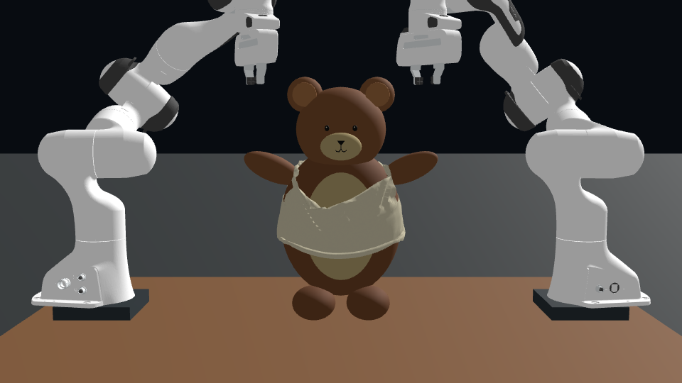

# 仅凭三张初始图重建的 Genesis 熊穿衣场景

这是一个独立建立、可运行的**估计模型与辅助穿衣仿真**。输入只有用户给出的三张 PNG 和“包住熊的肚子、两端魔术贴互黏、双臂穿出两个袖口”的描述。未读取原有熊穿衣项目、动作数据或物性文件。标准 Franka 模型来自本地 Genesis 自带资产，熊和衣服由程序重新生成。

三张静态图不能唯一确定真实尺寸、质量、布料刚度、摩擦、黏合强度、熊的内部结构或动作。这里的数值是可更改的重建假设，不是对原仿真参数的识别结果。

[全景视频](output/ipc_dressing_native/ipc_reconstruction.mp4) · [正反面视频](output/ipc_dressing_native/ipc_front_back.mp4) · [验证摘要](output/ipc_dressing_native/result_summary.json)



## 仓库内容

本仓库包含完整源代码、程序生成的模型、三张输入参考图，以及 `output/` 下的各轮仿真记录。主结果是 `output/ipc_dressing_native/`；其它输出包含调试和未通过验证的试验，应结合各自报告阅读。第三方依赖 `.deps/`、编译缓存 `.cache/` 和 Python 缓存不纳入版本管理。

`delivery_manifest.json` 记录的是最初交付压缩包的文件哈希，不是此后每次 Git 提交的清单。仓库中的后续修改由 Git 记录。当前运行脚本使用本机的 Genesis 路径；在其它机器上使用时请设置 `GENESIS_PYTHON` 和 `CUDA12_LIBRARY_ROOT`，并安装 `requirements-ipc.txt` 中的依赖。

## 已完成的验证

原生版本实际运行了 12 秒、1200 步。全部布料位置引导释放后继续运行 2.8 秒；44 对原生连接保持闭合，最大连接间距 2.026 mm；最终最大边长伸长约 5.20%。在 z=0.95 m 和 1.00 m 两个腹部截面，布料角向覆盖率均为 100%。没有检测到躯干椭球内 98% 区域的布料顶点。

`validation.json` 保留严格“肩点到腕点”的原始检验结果；该定义下右侧未通过。`finite_arm_validation.json` 单独检查完整手臂网格的长轴：模型手臂实体比肩点多延伸 18 mm，而右袖口在肩点内侧约 0.7 mm，因此完整实体轴仍穿过右袖孔。两种检验的定义与结果均保留，不覆盖原来的失败项。

两只完整手臂实体轴在释放阶段的全部 57 个记录帧中均穿过对应袖孔，且不穿过布料材料三角面。最终帧的完整手臂网格检查也没有发现非共面三角面相交或布料顶点位于手臂内部。这仍不是对连续时间、共面重叠或正间隙的独立数学证明。可用 `python finite_arm_validate.py output/ipc_dressing_native` 重跑这一检查。

这些验证针对当前估计几何及辅助动作，不等于原仿真参数恢复或双机器人真实抓取验证。`success_certified=false` 保留这一更严格的任务边界。

## 运行

当前主版本使用 Genesis 的原生 **FEM 薄壳 + CUDA IPC**，包括三角面连续碰撞、自接触与摩擦。本机可执行：

```bash
./run.sh
```

它会保存新结果到 `output/new_native_run/`。也可以分别执行物理和渲染：

```bash
./run_ipc.sh --mode dressing --steps 1000 --settle-steps 200 --no-render --no-robots --out output/ipc_dressing_native
/home/chloe/Desktop/genesis-local/.venv/bin/python render_ipc_replay.py output/ipc_dressing_native/trajectory.npz --width 960
```

第一步计算物理并保存轨迹；第二步在独立的 CPU 渲染进程中逐帧显示已记录的原生布料顶点，不重新计算物理，也不替换轨迹。这样避开本机 CUDA IPC 与 EGL 同进程时发生的渲染崩溃。回放中的机器人使用示意 IK 动作，熊手臂使用物理记录的完整仿射变换。

`run_ipc.sh` 使用本机已有 Genesis 解释器及 CUDA 12 动态库；库目录可用 `CUDA12_LIBRARY_ROOT` 改写。IPC 所需 `pyuipc==0.0.7`、`polyscope==2.6.1` 安装在本项目 `.deps/`，未修改原 Genesis 环境。GPU 计算需要在能够访问 NVIDIA 驱动的环境中执行。

源码压缩包不包含第三方依赖、缓存及失败试验视频；当前本地工程已具备运行依赖。移到其它目录或机器时，需要安装 Genesis 及 `requirements-ipc.txt` 中的依赖，并配置可用的 CUDA 12 库与 Python 路径。

早期 PBD 对照版本**未通过松手后的稳定性测试**，保留用于检查失败原因：

```bash
./run_pbd.sh --steps 600 --settle-steps 150 --strain-limit --out output/final_candidate
```

只查看初始场景：

```bash
./run_pbd.sh --initial-only --out output/initial
```

加 `--viewer` 可打开 Genesis 窗口；PBD 版本默认使用 CPU 和 Mesa EGL 离屏渲染。本机 NVIDIA RTX 5070 Laptop GPU 与驱动工作正常，但 Codex 默认沙箱不暴露 CUDA；GPU 仿真需要在允许访问 GPU 的执行环境运行。默认解释器为 `/home/chloe/Desktop/genesis-local/.venv/bin/python`，可通过 `GENESIS_PYTHON` 指定其它已安装 Genesis 的解释器。

`run_pbd.sh` 默认开启自定义接触扩展并录制正反面细节视频。直接运行 `run_sim.py` 可以分别开关 `--contact-extension`、`--strain-limit`；关闭扩展会改变物理模型，不保证原结果。`--servo` 是未完成真实抓取验证的实验性机械臂关节伺服选项。

## 输出与判定

指定输出目录包含：

原生 IPC 主结果位于 `output/ipc_dressing_native/`：`ipc_reconstruction.mp4`、`ipc_front_back.mp4`、`trajectory.npz`、`report.json`、`validation.json`。以下 PBD 文件名与统计供对照。

- `reconstruction.mp4`：完整动作全景；画面标出辅助约束数量及黏合数。
- `front_back.mp4`：同时展示正面穿袖与背部闭合。
- `initial_*.png`、`final_*.png`：初始和结束的多个视角。
- `trajectory.npz`：布料位置、真实重网格后的三角形和边、袖孔、黏合配对、熊手臂线段、时间；新运行也保存机械臂关节姿态。
- `report.json`：本次配置、估计物性、释放时长、最终数值及限制。
- `validation.json`：两个真实袖孔的拓扑、手臂轴是否穿孔、材料边伸长、躯干覆盖与穿透检查。
- `metrics.json`、`contact_metrics.json`、`strain_metrics.json`：随时间的状态和扩展约束统计。

最后阶段会释放**全部布料位置引导**，保留布料自身约束、接触和两端相互黏合；熊仍是固定支撑物，手臂保持指定姿态。不能只看闭合前的好看画面，必须结合松开后的图像与验证结果。`success_certified` 始终为 false：本项目没有验证原仿真复现、完整有限厚度连续碰撞、真实机器人抓取可行性或自主策略。

## 明确使用的假设

原生 IPC 采用 `FEM.Cloth(E=60000 Pa, nu=0.3, rho=240 kg/m³, thickness=1 mm, bending_stiffness=0.01, friction_mu=0.6)`，每步 0.01 s。布料边缘及袖口外侧上缘使用原生软位置约束，进度达到 92% 时全部释放。魔术贴用指定顶点之间的原生 `SoftVertexStitch` 近似：实际间距小于 20 mm 才允许连接，rest_length=1.5 mm，kappa=1e6；没有剥离或断裂模型。

本地 pyuipc 版本不支持在原 World 内热更新 stitch 刚度。因此闭合时创建一次新的原生 Engine/World，并恢复 FEM 位置与速度、ABD 变换与速度，保留原始静止形状；恢复误差记录在 `report.json`。这是显式的数值实现细节，不代表真实魔术贴的微观结构。

下面的 PBD 数值属于早期对照版本；几何假设在两版之间共享：

| 项目 | 当前估计 |
|---|---|
| 桌面 | 1.40 × 0.98 m，高 0.75 m |
| 熊躯干 | 固定椭球，中心 (0, 0.10, 0.965) m，半径 (0.135, 0.108, 0.168) m |
| 熊的手臂 | 独立刚性椭球，穿袖时按设计轨迹向外抬起 80°，非恢复的关节控制 |
| 衣服 | 0.80 × 0.19 m 的薄布带，两个真实 0.070 × 0.076 m 开孔 |
| 袖孔中心 | 布料材料坐标 u = ±0.205 m，v = 0.045 m |
| 布料面密度 | 0.24 kg/m²，约 34 g |
| Genesis 布料 | PBD；拉伸 compliance 2e-8，弯曲 compliance 3e-5 |
| 时间积分 | 每步 0.02 s、8 个子步；随机种子 7 |
| 自定义接触 | 估计躯干/手臂椭球、粒子扫掠检测、近似库仑摩擦系数 0.6 |
| 魔术贴 | 两端指定粒子配对距离小于 24 mm 后黏合，数值层间距 13 mm；不含真实剥离与断裂 |

13 mm 是粗粒子离散下用于避免自碰撞冲突的**数值黏合间距**，不是从图片估计出的魔术贴厚度。应变限制器是额外的边长投影；固定引导之间发生冲突时，它会报告残余应变，不会保证材料绝不伸长。

## 控制与物理范围

Genesis 确实计算自由布料的运动、重力、材料响应和刚体接触。机械臂做 IK 姿态重放。布料的边缘及袖口上缘还有额外的位置引导，因此这里**没有证明两台机器人仅靠真实夹爪作用就能完成穿衣**。画面中的机械臂不是全部辅助力的唯一来源。熊的手臂有设计的外展动作；填充熊被简化为刚性部件，不是已识别物性的软体玩具。

本地 Genesis 1.4.3 的 Legacy PBD—Rigid 耦合未实现切向摩擦，也没有原生魔术贴。`contact_extension.py` 和 `strain_limiter.py` 是本项目显式增加的近似约束，没有修改已安装的 Genesis 源码。接触扩展检查粒子轨迹，不能替代三角面连续碰撞检测。熊未建成填充物软体模型。

## 文件

- `parameters.py`：主要几何假设与最终手臂外展角。
- `assets_builder.py`：程序化熊模型。
- `cloth_model.py`：有真实袖孔的布料网格、纹理与魔术贴区域。
- `trajectory.py`：根据图片和任务设计的分阶段参考动作。
- `run_sim.py`：Genesis 场景、机械臂、物理运行、黏合与输出。
- `run_ipc.py`、`run_ipc.sh`：原生薄壳、IPC 接触、软引导与原生连接。
- `render_ipc_replay.py`：将原生记录精确回放为视频，带资产一致性检查。
- `contact_extension.py`、`strain_limiter.py`：可选物理近似扩展。
- `validate.py`：独立几何与变形验证。
- `finite_arm_validate.py`：完整手臂网格与袖孔的补充检验，保留原肩腕段检验。
- `provenance.json`：三张输入图的哈希、本地引擎提交及依赖版本。

官方背景资料：[Genesis IPC 文档](https://genesis-world.readthedocs.io/en/v1.4.0/user_guide/theory/coupling/ipc_coupler.html)、[Genesis PBD 文档](https://genesis-world.readthedocs.io/en/latest/api_reference/engine/solvers/pbd_solver.html)。本实现以本地安装的实际 API 为准。
